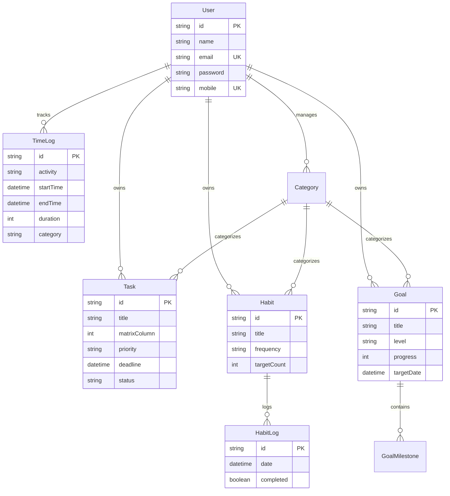

# Momentum — Personal Habit & Productivity OS

> **"Small habits. Compound returns."**  
> A calm, high-performance personal operating system built to replace the friction of spreadsheets with intuitive habit tracking, Eisenhower prioritization, automated time logging, and deep analytics.

---

## ✦ Overview

**Momentum** is designed around a simple truth: *personal productivity tools should feel calm, fast, and rewarding to open every morning—not like an overwhelming enterprise SaaS dashboard.*

It merges the speed and monthly bird's-eye view of a Google Sheets tracker with modern web app capabilities: optimistic zero-latency interactions, automated gap detection in time logs, structured goal milestone tracking, and 90-day consistency heatmaps.

---

## ✦ Key Features

### 1. 📅 Spreadsheet-Speed Habit Tracker (`/habits`)
- **Monthly Dense Grid**: High-density monthly view of daily habits with keyboard and click navigation.
- **Weekly & Monthly Rollups**: Automatic completion percentages calculated by week and month.
- **Streak Counters & Badges**: Real-time streak tracking with dynamic milestone badges (🔥).
- **Progress Donut Visualizer**: Circular completion gauges that recalculate on the fly.
- **Optimistic UI**: Instant checkbox toggling without network delay or page refresh.

### 2. ⏳ Daily Time Log & Auto-Gap Timeline (`/timelog`)
- **Vertical Day-Planner Timeline**: Chronological log of focus blocks, deep work sessions, study, and workouts.
- **Smart Auto-Gap Engine**: Automatically computes unlogged gaps between activities (starting from 6:00 AM) and renders them as muted "Wasted / Unlogged" intervals—no manual logging of downtime required.
- **Battery Summary Bar**: A horizontal dual-tone gauge showing your exact daily ratio of productive focus hours versus downtime.

### 3. 🎯 Eisenhower Priority Matrix (`/priority`)
- **Four-Quadrant System**:
  - **Q1 (Do Now)**: Urgent & Important
  - **Q2 (Schedule)**: Important, Not Urgent
  - **Q3 (Delegate)**: Urgent, Not Important
  - **Q4 (Eliminate)**: Neither Urgent nor Important
- **Quick-Add Interface**: Categorized task creation with duration estimation, priority weighting, and deadline tracking.

### 4. 🏆 Goal & Milestone Engine (`/goals`)
- **Multi-Horizon Tracking**: Organize ambitions into **Short-Term**, **Medium-Term**, and **Long-Term** horizons.
- **Milestone Checklists**: Granular progress bars that advance dynamically as sub-milestones are completed.
- **Deadline Countdowns**: Visual urgency indicators that highlight at-risk targets.

### 5. 📊 Deep Productivity Analytics (`/analytics`)
- **90-Day GitHub-Style Heatmap**: Visual matrix tracking daily consistency across all habits over the last quarter.
- **Daily Habit Score Curve**: Smooth wavy area graph visualizing daily execution percentages.
- **Category Donut Breakdown**: Time distribution charts grouped by customized categories (Deep Work, Health, Study, Side Projects).

### 6. 💡 Ideas Scratchpad (`/dashboard`)
- Direct access dashboard widget to capture spontaneous course ideas, micro-SaaS concepts, and reading lists.

---

## ✦ Tech Stack

| Layer | Technology |
|---|---|
| **Framework** | [Next.js 16](https://nextjs.org/) (App Router, Server Actions, Turbopack) |
| **Frontend** | [React 19](https://react.dev/), [TypeScript](https://www.typescriptlang.org/) |
| **Styling** | [Tailwind CSS v4](https://tailwindcss.com/), CSS-first theme variables |
| **Components** | [shadcn/ui](https://ui.shadcn.com/) (base-nova, neutral palette) |
| **Database & ORM** | [PostgreSQL](https://www.postgresql.org/) via [Prisma ORM 5](https://www.prisma.io/) |
| **Cloud Backend** | [InsForge](https://insforge.dev/) Managed PostgreSQL Cloud Infrastructure |
| **Authentication** | [NextAuth.js](https://next-auth.js.org/) (Credentials Provider, JWT Sessions, Bcrypt) |
| **State & Drag/Drop**| [Zustand](https://zustand-demo.pmnd.rs/), [@dnd-kit](https://dndkit.com/) |
| **Data Visualization**| [Recharts](https://recharts.org/) (Heatmaps, Wavy Area Curves, Donut Gauges) |
| **Icons & Feedback** | [Lucide React](https://lucide.dev/), [Sonner Toasts](https://sonner.emilkowal.ski/) |

---

## ✦ Database Architecture



---

## ✦ Getting Started Locally

### 1. Prerequisites
- **Node.js**: `v20.x` or later
- **npm** or **pnpm**
- A **PostgreSQL** database (e.g., [InsForge](https://insforge.dev/), Supabase, or local PostgreSQL)

### 2. Clone the Repository
```bash
git clone https://github.com/Amanjain1974/Habit-Tracker.git
cd Habit-Tracker
```

### 3. Install Dependencies
```bash
npm install
```

### 4. Configure Environment Variables
Create a `.env` file in the root directory:
```env
# Application Secrets
NEXTAUTH_SECRET="your_nextauth_secret_key"
NEXTAUTH_URL="http://localhost:3000"

# Database Connection (PostgreSQL)
DATABASE_URL="postgresql://<USER>:<PASSWORD>@<HOST>:5432/<DATABASE>?sslmode=require"
```

### 5. Synchronize Database Schema
Push the Prisma models to your database:
```bash
npx prisma db push
```

### 6. Start the Development Server
```bash
npm run dev
```

Visit **[http://localhost:3000](http://localhost:3000)** in your browser.

---

## ✦ Application Navigation

| Route | View Description |
|---|---|
| `/dashboard` | Today’s executive summary, active priorities, consistency score & ideas widget |
| `/habits` | The core monthly spreadsheet grid with checkbox logs and streak badges |
| `/priority` | 4-Quadrant Eisenhower Matrix for task execution |
| `/goals` | Short-term, medium-term, and long-term milestones |
| `/timelog` | 24-hour day planner with auto-gap calculation & battery summary bar |
| `/analytics` | 90-day consistency heatmap, completion trends, and category distribution |
| `/login` & `/register` | Minimalist branded authentication screens |

---

## ✦ Design System Philosophy

- **Color Palette**: Neutral warm base (off-white light mode, soft charcoal dark mode) with a confident forest green accent color (`#059669` / `primary`) reserved strictly for CTAs, streaks, and progress.
- **Non-Guilt Wasted Time Tone**: Unlogged / wasted timeline blocks utilize soft muted amber tones rather than jarring alarm red, preserving a calm and encouraging user experience.
- **Typography**: Editorial serif headings paired with clean, geometric sans-serif for numbers, tables, and data density.

---

## ✦ Author

Built with pride by **Aman Jain**  
GitHub: [@Amanjain1974](https://github.com/Amanjain1974)
